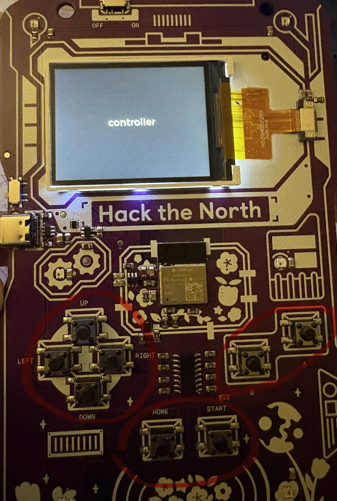

# Elden32

[](https://www.youtube.com/watch?v=PrTp-e8Cqpc "elden32")

short youtube vid of first mini boss (embedded in image or here: https://www.youtube.com/watch?v=PrTp-e8Cqpc)

## This is what the full board looks like with the ESP32 and the 8 buttons (this is the controller)


```
There are 18 mandatory buttons that need to be mapped across the entire game to mouse and keyboard inputs
The keyboard keys for these buttons are:
W - (moving forward)
A - (moving left)
S - (moving back)
D - (moving right)
R - (using an item/healing)
Space - (Rolling/Dodging)
Left Click - (Attacking/Swinging Weapon)
Up Arrow - (Menu and inventory navigation)
Left Arrow - (Menu and inventory navigation)
Down Arrow - (Menu and inventory navigation)
Right Arrow - (Menu and inventory navigation)
M - (Open the map)
Q - (Camera lock on to target)
E - (Interact / Select)
Esc - (Open any kind of menu or settings page / close dialogues)
Enter - (Required for some specific options where E doesnt suffice)
X - (Required to move around in specific inventory and settings pages)
F - (Jump, not actually required for bosses but required to traverse specific areas of the game)

These are how all of these 18 keys are mapped to the 8 buttons:
The most important button of the 8 buttons that exist on the board is the home button, the home button acts as a "configuration switch". There are two configurations, configuration 1 "Attacking" and configuration 2 "exploring".

Pressing home flips a boolean flag which swaps the configuration from 1 to 2 or vice versa in the program.
This allows for the mapping of 7 + 7 extra buttons totalling 14 (excluding home) rather than the original 8.

On top of this we still need 4 extra mappings, these mappings are for buttons that arent as commonly used and/or are more situational and they include the last four in the above list: ESC, ENTER, X, and F.

Before going into how these are mapped we'll dicuss how the rest of the buttons are mapped first on the 14 different available spots. 

The UP, LEFT, RIGHT, DOWN buttons on the controller use  W, A, S, D for configuration 1 "Attacking" corresponding to each direction whereas configuration 2 uses the UP ARROW KEY, LEFT ARROW KEY, DOWN ARROW KEY, and RIGHT ARROW KEY for the same buttons corresponding to menu navigation.

The START button corresponds to "use item/heal" which is R in configuration 1 "Attacking" and M which is the map in the 2nd configuration "exploring".

The B button corresponds to "rolling/dodging" which is SPACE in configuration 1 "Attacking" and Q which is camera lock on in the 2nd configuration "exploring".

The A button corresponds to "attacking/swinging weapon" which is left click in configuration 1 "Attacking" and E which is interact/select in the 2nd configuration "exploring".

To summarize:
Available Buttons | Configuration 1 | Configuration 2
UP                  W                 UP ARROW
LEFT                A                 LEFT ARROW
DOWN                S                 DOWN ARROW
RIGHT               D                 RIGHT ARROW
HOME                (swaps config)    (swaps config)
START               R                 M
B                   SPACE             Q
A                   LEFT CLICK        E
```